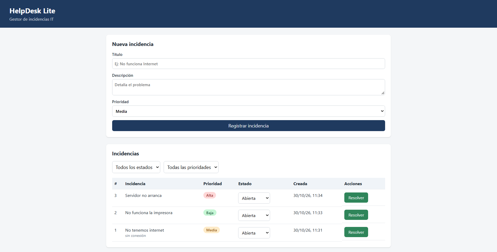
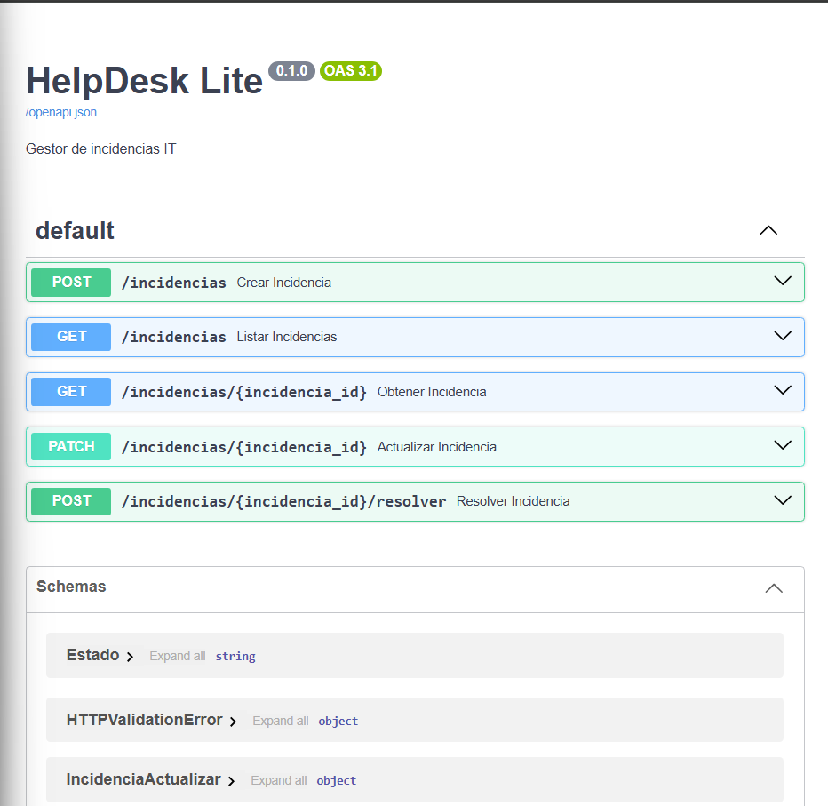

# HelpDesk Lite - ITSM

[](https://github.com/Virus34558/helpdesk-lite/actions/workflows/tests.yml)

Sistema de gestión de incidencias y soporte técnico (ITSM) desarrollado en **FastAPI** y **SQLAlchemy**. Permite centralizar la recepción, gestión y resolución de tickets, con control de acceso basado en roles (**RBAC**), autenticación **JWT** y filtros operativos.

**Demo en vivo:** helpdesk-lite-6x8a.onrender.com/

> La demo está en un plan gratuito: si lleva un rato sin visitas, la primera carga puede tardar alrededor de un minuto en despertar. Es una demo pública, no introduzcas datos reales.



## Qué permite hacer

### Gestión de Incidencias
- Crear incidencias con título, descripción y prioridad (Alta, Media, Baja).
- Cambiar estados operativos: `Abierta`, `En proceso`, `Resuelta`.
- Resolver incidencias con un solo clic (con sellado de fecha de resolución).
- Filtrar incidencias por estado y prioridad en tiempo real.
- Validación estricta con Pydantic: longitud mínima de títulos y control de enumerados válidos.

### Autenticación y Control de Acceso (RBAC)
- **4 Roles de Usuario (ITSM):** `solicitante` (usuario final), `agente` (técnico N1-N3), `supervisor` (team lead) y `administrador`.
- **Criptografía segura:** contraseñas hasheadas con `bcrypt` (12 rondas de *salting*).
- **Sesiones con JWT:** emisión y validación de tokens Bearer (`HS256`) con expiración.
- **Auto-promoción inicial:** el primer usuario registrado en el sistema se convierte automáticamente en `administrador`.
- **Protección de rutas:** validación de permisos en endpoints (ej. solo supervisores y administradores pueden listar usuarios).

---

## Tecnologías

- **Python** y **FastAPI**: API REST de alto rendimiento con documentación OpenAPI interactiva en `/docs`.
- **SQLAlchemy 2.0**: ORM y capa de acceso a base de datos.
- **SQLite** en desarrollo local y **PostgreSQL** (`psycopg3`) en producción.
- **Criptografía y Tokens**: `bcrypt` para passwords y `PyJWT` para autenticación con tokens de acceso.
- **HTML, CSS y JavaScript**: Interfaz ligera sin frameworks externos.
- **pytest**: 20 tests automáticos para incidencias, autenticación y RBAC.
- **GitHub Actions**: Pipeline de CI que ejecuta los tests en cada subida.
- **Docker**: Contenedor listo para despliegue basado en `python:3.13-slim`.
- **Render**: Plataforma de despliegue en la nube.

---

## API

### Módulo de Autenticación y Roles (`/auth`)

| Acción | Método y ruta | Acceso requerido |
|---|---|---|
| Registrar nuevo usuario | `POST /auth/registro` | Público |
| Iniciar sesión (obtener JWT) | `POST /auth/login` | Público |
| Consultar perfil en sesión | `GET /auth/me` | Autenticado |
| Listar usuarios del sistema | `GET /auth/usuarios` | `supervisor`, `administrador` |
| Modificar rol de usuario | `PATCH /auth/usuarios/{id}/rol` | `administrador` |

### Módulo de Incidencias (`/incidencias`)

| Acción | Método y ruta |
|---|---|
| Crear incidencia | `POST /incidencias` |
| Listar (con filtros) | `GET /incidencias?estado=Abierta&prioridad=Alta` |
| Consultar una incidencia | `GET /incidencias/{id}` |
| Actualizar campos o estado | `PATCH /incidencias/{id}` |
| Resolver incidencia | `POST /incidencias/{id}/resolver` |

Documentación interactiva disponible en `/docs`:



---

## Ejecutar en local

```bash
git clone https://github.com/Virus34558/helpdesk-lite.git
cd helpdesk-lite
python -m venv venv
venv\Scripts\activate        # En Mac/Linux: source venv/bin/activate
pip install -r requirements.txt
uvicorn app.main:app --reload
```

Abre http://127.0.0.1:8000 en tu navegador, o consulta http://127.0.0.1:8000/docs para la documentación Swagger interactiva.

---

## Ejecutar con Docker

```bash
docker build -t helpdesk-lite .
docker run -p 8000:8000 helpdesk-lite
```

---

## Tests

```bash
pip install -r requirements-dev.txt
python -m pytest -v
```

Los tests utilizan una base de datos temporal en memoria (`StaticPool`), garantizando velocidad y aislamiento total sin alterar los datos locales.

---

## Estructura del Proyecto

```
helpdesk-lite/
|-- app/
|   |-- routers/
|   |   `-- auth.py      # Endpoints de autenticacion y usuarios
|   |-- auth.py          # Logica criptografica (bcrypt), JWT y dependencias RBAC
|   |-- database.py      # Conexion y sesion de base de datos
|   |-- main.py          # Inicializacion de FastAPI y rutas principales
|   |-- models.py        # Modelos ORM (Usuario, Incidencia) con SQLAlchemy
|   |-- schemas.py       # Esquemas de validacion y serializacion (Pydantic v2)
|   `-- static/
|       `-- index.html   # Interfaz web de usuario
|-- tests/
|   |-- conftest.py          # Fixtures y configuracion de BD en memoria
|   |-- test_auth.py         # Tests de autenticacion, login y permisos RBAC
|   `-- test_incidencias.py  # Tests de incidencias, filtros y estados
|-- .github/workflows/       # Pipeline CI con GitHub Actions
|-- Dockerfile
|-- requirements.txt
|-- requirements-dev.txt
`-- README.md
```

---

## Roadmap y Próximas Mejoras

- [x] Autenticación de usuarios y roles RBAC (`solicitante`, `agente`, `supervisor`, `administrador`)
- [ ] Modelo `Ticket` con identificador legible (`INC-YYYY-XXXX`) y matriz ITIL (Impacto × Urgencia = Prioridad P1–P4)
- [ ] Asignación de tickets a agentes técnicos y grupos de soporte
- [ ] Hilo de comunicación dual: respuestas públicas al solicitante vs. notas internas para agentes
- [ ] Motor de SLAs con calendarios laborales y pausa de temporizador ("Stop the clock")
- [ ] Base de Conocimiento (Knowledge Base) con deflexión de tickets al escribir el asunto
- [ ] Migraciones de base de datos con Alembic
- [ ] Paginación y búsqueda rápida

---

## Autor

Hecho por [Virus34558](https://github.com/Virus34558) como proyecto de portfolio.
